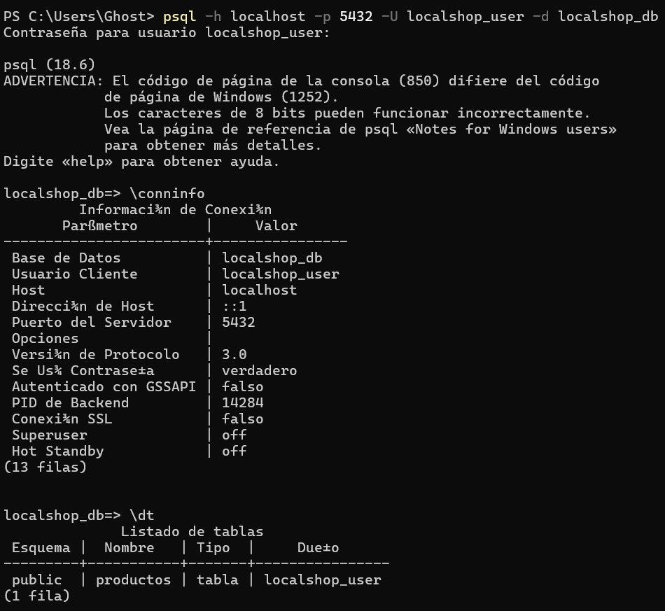
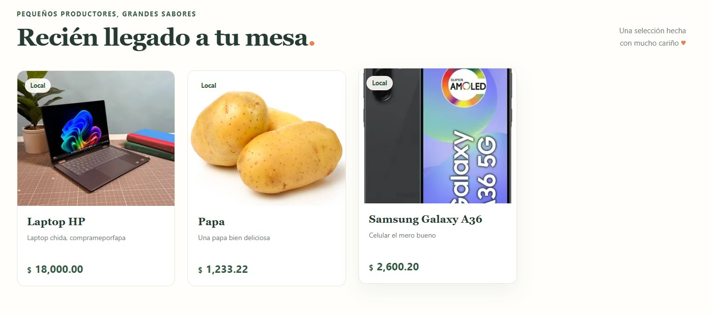

# LocalShop PWA

Aplicación web progresiva para descubrir productos de productores locales. Está construida con Spring Boot y Thymeleaf, y ofrece un catálogo renderizado en el servidor, registro de productos, instalación como aplicación y una experiencia offline básica.

## Funcionalidades

- Consulta y registro de productos con nombre, descripción, precio y URL opcional de imagen.
- Renderizado del catálogo en el servidor con Thymeleaf y persistencia mediante Spring Data JPA.
- Manifiesto e instalación como PWA en navegadores compatibles.
- Service Worker que almacena recursos de la aplicación y la última portada visitada para ofrecer una alternativa offline.
- Consulta de la ubicación del dispositivo y enlace para abrir las coordenadas en OpenStreetMap. Esta función no busca tiendas cercanas.

## Tecnologías

- Java 17 y Spring Boot 4.1.2.
- Spring Web MVC, Spring Data JPA y Thymeleaf.
- PostgreSQL para la ejecución normal; H2 se utiliza únicamente en las pruebas.
- Lombok.
- HTML, CSS y JavaScript; los estilos son propios (el proyecto no incluye Bootstrap).
- Web App Manifest, Service Worker y Geolocation API.

## Requisitos

- JDK 17 o superior.
- PostgreSQL disponible localmente.
- Navegador moderno. Chrome es útil para probar instalación y Lighthouse.
- El repositorio incluye Maven Wrapper (`mvnw` / `mvnw.cmd`), así que no es necesario instalar Maven por separado.

## Configuración de la base de datos

La aplicación espera por defecto una base PostgreSQL llamada `localshop_db` en `localhost:5432`, con el usuario `localshop_user`. Hibernate valida el esquema al arrancar (`ddl-auto=validate`), por lo que la base de datos y la tabla deben existir previamente. En `psql`, crea el usuario y la base de datos (se solicitará la contraseña):

```text
CREATE ROLE localshop_user WITH LOGIN;
\password localshop_user
CREATE DATABASE localshop_db OWNER localshop_user;
\connect localshop_db
```

Después, ejecuta en `localshop_db`:

```sql
CREATE TABLE productos (
    id BIGINT GENERATED BY DEFAULT AS IDENTITY PRIMARY KEY,
    nombre VARCHAR(255) NOT NULL,
    descripcion VARCHAR(1000) NOT NULL,
    precio NUMERIC(12, 2) NOT NULL,
    imagen_url VARCHAR(1000)
);
```

La URL y el usuario pueden sobrescribirse mediante `LOCALSHOP_DB_URL` y `LOCALSHOP_DB_USERNAME`. Configura la contraseña con `SPRING_DATASOURCE_PASSWORD` y no guardes credenciales reales en Git. La configuración de conexión está en `src/main/resources/application.properties`.

## Ejecución local

Desde la raíz del proyecto, en Windows:

```powershell
$env:LOCALSHOP_DB_URL = "jdbc:postgresql://localhost:5432/localshop_db"
$env:LOCALSHOP_DB_USERNAME = "localshop_user"
$env:SPRING_DATASOURCE_PASSWORD = "<contraseña-de-PostgreSQL>"
.\mvnw.cmd spring-boot:run
```

En Linux o macOS:

```bash
export LOCALSHOP_DB_URL="jdbc:postgresql://localhost:5432/localshop_db"
export LOCALSHOP_DB_USERNAME="localshop_user"
export SPRING_DATASOURCE_PASSWORD="<contraseña-de-PostgreSQL>"
./mvnw spring-boot:run
```

Luego abre [http://localhost:8080](http://localhost:8080).

## Uso

1. Revisa los productos disponibles en el catálogo.
2. Usa el formulario **Registrar producto** para añadir uno. La imagen es opcional y se captura como URL.
3. Pulsa **Encontrar tiendas** y concede permiso de ubicación para ver tus coordenadas y abrirlas en OpenStreetMap.
4. En un navegador compatible, usa **Instalar app** cuando aparezca para instalar Localshop.

La ubicación y la instalación requieren un contexto seguro; `localhost` está permitido para desarrollo. La portada offline depende de que se haya visitado antes con conexión. Las operaciones del catálogo requieren que el servidor y PostgreSQL estén disponibles.

## Pruebas

Ejecuta la prueba automatizada con:

```powershell
.\mvnw.cmd test
```

En Linux o macOS, usa `./mvnw test`. Actualmente la prueba del proyecto comprueba que el contexto de Spring arranque; las verificaciones manuales de Lighthouse, uso offline e instalación deben registrarse como resultados separados cuando se realicen.

## Capturas de pantalla

Las capturas actuales muestran la conexión con PostgreSQL y el catálogo:





Para ampliar la documentación, agrega capturas del formulario de registro, el resultado de ubicación, la instalación de la PWA y la portada mostrada sin conexión. Guarda cada archivo dentro de `img/` y enlázalo con Markdown, por ejemplo: ``.

## Estructura principal

```text
src/
├── main/
│   ├── java/com/pwa/localshop/       # Aplicación, controlador, modelo y repositorio
│   └── resources/
│       ├── static/                   # CSS, JavaScript, manifiesto, Service Worker e imágenes
│       └── templates/                # Vistas Thymeleaf
└── test/                             # Pruebas y configuración H2
img/                                  # Capturas de pantalla para la documentación
```

## Autores

- Vitaliano Cordova
- Sergio Ramos
- Jesús Rodriguez
- Daniel Peregrino
- Juan Gonzalez
- Jesus Morales
